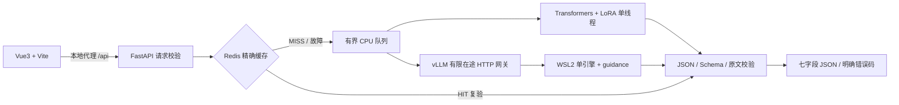

# SlimLLM

**面向中文电商售后工单的轻量大模型微调与结构化推理服务。**

在 RTX 4060 Laptop 8GB 上，围绕 Qwen3-1.7B 完成合成数据治理、NF4 QLoRA、FastAPI 服务、有界 FIFO、Redis 精确缓存、WSL2 vLLM 和 Vue3 演示页。定位为可追溯、可讲清技术取舍的单机求职项目。

训练/测试工单由 **DeepSeek API 合成，不是真实客户数据，也没有独立人工业务金标**。下列指标来自本机实测；不是生产 SLA。仓库不包含模型、Adapter、完整数据或虚拟环境，**仅克隆代码不能直接重现模型结果**。

[运行说明](docs/RUNNING.md) · [模型与 Adapter 准备](docs/ARTIFACTS.md) · [项目总结/面试问答](reports/project_summary.md) · [简历描述](docs/resume.md) · [发布步骤](docs/PUBLISHING.md)

## 核心功能

- 七字段工单抽取：intent、order_id、product_name、issue_type、priority、requested_action、reason。
- NF4 QLoRA：LoRA r=8、batch=1、梯度检查点、答案专用损失，只保存最终 Adapter，不 merge。
- FastAPI `/extract`、`/health`：参数校验、严格 JSON/Pydantic/原文片段校验、明确错误码。
- 有界 FIFO：默认 8 个等待名额、30 秒等待上限；Transformers 单模型线程，Redis 故障可降级。
- 可选 WSL2 vLLM：单 GPU 引擎、最多 2 个序列；完整 JSON Schema 约束解码，保留 Transformers 回退。
- Vue3 + Vite：输入/示例、JSON/字段视图、复制、耗时、健康状态与错误提示。

## 真实实验结果

### QLoRA：固定 50 条合成测试工单

| 指标 | 基座 | 微调后 |
| --- | ---: | ---: |
| JSON / Schema 合法率 | 各 100% | 各 100% |
| 七字段宏准确率 | 63.71%（223/350） | **85.14%（298/350）** |
| 整条精确匹配 | 6%（3/50） | 20%（10/50） |

数据共 499 条，冻结划分 399/50/50。字段宏准确率增加 **21.43 个百分点**；reason 片段边界不同也会计错。训练/验证循环约 1018 秒，训练阶段 PyTorch 已分配显存峰值约 3.10 GiB（加载约 4.43 GiB），Adapter 约 6.16 MiB；服务推理使用 FP16 基座 + LoRA。

### vLLM：未开启约束解码的历史性能对照

同一 32 条冻结工单、每档 32 次请求、预热排除，Redis/prefix cache 关闭；两后端各档均 32/32 成功。

| 客户端并发 | Transformers + FIFO RPS | vLLM RPS | FIFO → vLLM P95（秒） |
| ---: | ---: | ---: | ---: |
| 1 | 0.370 | 0.400 | 3.172 → 3.815 |
| 2 | 0.371 | 0.701 | 5.896 → 3.354 |
| 4 | 0.363 | 0.751 | 11.667 → 5.802 |
| 8 | 0.367 | **0.747** | **21.219 → 10.973** |

并发 8 的成功 RPS 约为参考的 2.03 倍；并发 1 P95 变差。vLLM 整卡显存采样峰值最高 7181 MiB，原 FIFO 为 4978 MiB。入口并发 8 通过排队接纳，**不等于 8 路 GPU 同时推理**。对比为非交错历史测量，系统/功耗/温度/后台负载未严格隔离；这不是当前约束解码模式的性能测量。

### 约束解码：格式与语义分别评测

同一 vLLM 引擎依次 off/on，单并发、固定提示词/输入 tokens、temperature=0、seed=42、max_tokens=384，各组两次预热排除。

| 数据集 | 枚举 / 完整 Schema 合法 | 四分类字段宏准确率 |
| --- | --- | --- |
| 冻结合成 N=50 | off/on 均 50/50 | 均 89.00%（178/200） |
| 独立手写/用户测试 N=12 | 11/12 → 12/12 | 89.58%（43/48） → 91.67%（44/48） |

两组 JSON 均全部合法。回归集只将非法动作“安排寄修”改为 repair；优先级等语义错误仍存在，整条匹配仍为 7/12。旧七字段得分 72/84 → 77/84 含“Schema 非法整条计错”的门槛影响，不能解释成五个原始字段都改善。冻结 50 条输出不变。完整口径、分子/分母及原始证据哈希见 [公开指标摘要](reports/project_metrics.json)。

## 架构与技术栈



两种模型后端择一驻留；不自动加载第二份 GPU 模型。技术栈：Python、PyTorch、Transformers、PEFT/TRL、bitsandbytes、FastAPI、Pydantic、Redis、vLLM、asyncio/httpx、Vue3/Vite。

vLLM 0.11.2 直接向 `/v1/completions` 顶层传 `structured_outputs.json`；引擎使用 guidance + disable_fallback，不使用弃用 guided_json API。已安装 XGrammar 0.1.25 对 pattern/长度组合的支持不满足本契约。`SLIMLLM_VLLM_STRUCTURED_OUTPUTS=json_schema|off`，模式/Schema/协议/版本参与缓存指纹。T1 实际语法检查 **75/76**：合法 Unicode `\uXXXX` 转义被拒绝的兼容边界已接受，普通 UTF-8 中文可用；未将失败改写为全通过。Transformers 的健康模式为 none，仍是生成后校验，没有同等约束解码保证。

## 目录

```text
slimllm/
├── runtime.py / schema.py / dataset.py    # 公共路径、契约与数据处理
├── serving/                              # FastAPI、两种推理后端、FIFO、Redis
├── training/                             # Baseline 与 QLoRA
├── evaluation/                           # 质量评测、压测与 API 功能检查
└── vllm_preflight.py                      # 只读环境诊断
frontend/                                 # Vue3 + Vite 源码及 lockfile
scripts/windows/                          # PowerShell 环境与 WSL 安装脚本
scripts/wsl/                              # Linux 环境安装与 vLLM 启动脚本
configs/                                  # Redis、WSL 示例与 vLLM 候选配置
requirements/                             # Windows/WSL 依赖与版本约束
tests/                                    # Python 契约/控制流测试
data/                                     # Schema 与手写样例
docs/                                     # 运行、制品、发布、简历说明
reports/project_metrics.json              # 公开聚合指标与来源哈希
```

## 本机启动与使用

Python 命令从项目根目录使用 `python -m slimllm.…`，不需要安装本项目包。模块分目录后，模型、数据、缓存和 Adapter 的原路径保持不变。

先按 [制品说明](docs/ARTIFACTS.md) 准备模型、Adapter 和推理提示词清单；本机这些制品已存在，无需再次下载、训练或安装。

终端一，默认 Transformers 后端：

```powershell
Set-Location 'B:\python\SlimLLM'
$env:SLIMLLM_BACKEND = 'transformers'
$env:SLIMLLM_REDIS_URL = ''
& '.\.venv\Scripts\python.exe' -B -m slimllm.serving.api --port 8000
```

终端二，前端（本机依赖已安装）：

```powershell
Set-Location 'B:\python\SlimLLM\frontend'
$env:TEMP = 'B:\python\SlimLLM\.cache\tmp'
$env:TMP = $env:TEMP
& 'B:\node\npm.cmd' run dev
```

访问 **http://127.0.0.1:5173**，输入一句工单并抽取/复制 JSON；API 文档为 http://127.0.0.1:8000/docs。用户已人工确认页面和交互正常，本仓库不展示前端截图。后端启动完成后再发请求；结束时分别 Ctrl+C。新环境依赖、WSL/vLLM、Redis、构建预览和错误排查见 [详细运行说明](docs/RUNNING.md)。

请求示例（也可使用 [HTTP 示例文件](docs/api_examples.http)）：

```http
POST http://127.0.0.1:8000/extract
Content-Type: application/json

{"text":"订单001234的蓝牙耳机左耳没有声音，我想退货退款。"}
```

本机真实模型响应示例，不保证任意输入/版本逐字相同：

```json
{"intent":"aftersales_request","order_id":"001234","product_name":"蓝牙耳机","issue_type":"quality","priority":"normal","requested_action":"return_refund","reason":"左耳没有声音"}
```

七键必填，缺失实体使用 null。422 为参数问题；502 包含 invalid_model_output / backend_request_rejected；503 为过载或服务不可用；504 为排队/后端超时。格式合法不能替代语义核查。

## 验证与边界

本机完整制品下 **97 项 Python 测试 + 10 项前端测试**通过；前端构建和真实代理到 Transformers + LoRA 的 2/2 功能样例通过，空输入 422 不增加推理计数。仅导出公开源码后，**42 项不依赖私有制品的 Python 测试 + 10 项前端测试通过**；直接跑全量 97 项会因未公开制品出现 4 个失败、47 个错误，未删断言或伪造文件隐藏问题。两种测试入口见 [测试说明](tests/README.md)。fixture 只验证协议/控制流，不能冒充模型结果；本次发布整理不重新进行 GPU 推理或压测。

没有干净机器端到端安装验证；Windows 实际 Python 3.13、WSL Python 3.12，二进制环境不能共用。单卡小样本、合成标签偏差、reason 边界、语义错误均仍存在；无公网鉴权/TLS/用户隔离/长期容量验证、流式接口或 TTFT，不声称生产成熟度。

源码与文档使用 [MIT](LICENSE)。模型、完整合成数据、Adapter、环境、缓存和原始日志均排除发布；第三方/数据的许可边界见 [THIRD_PARTY_NOTICES](THIRD_PARTY_NOTICES.md)。
